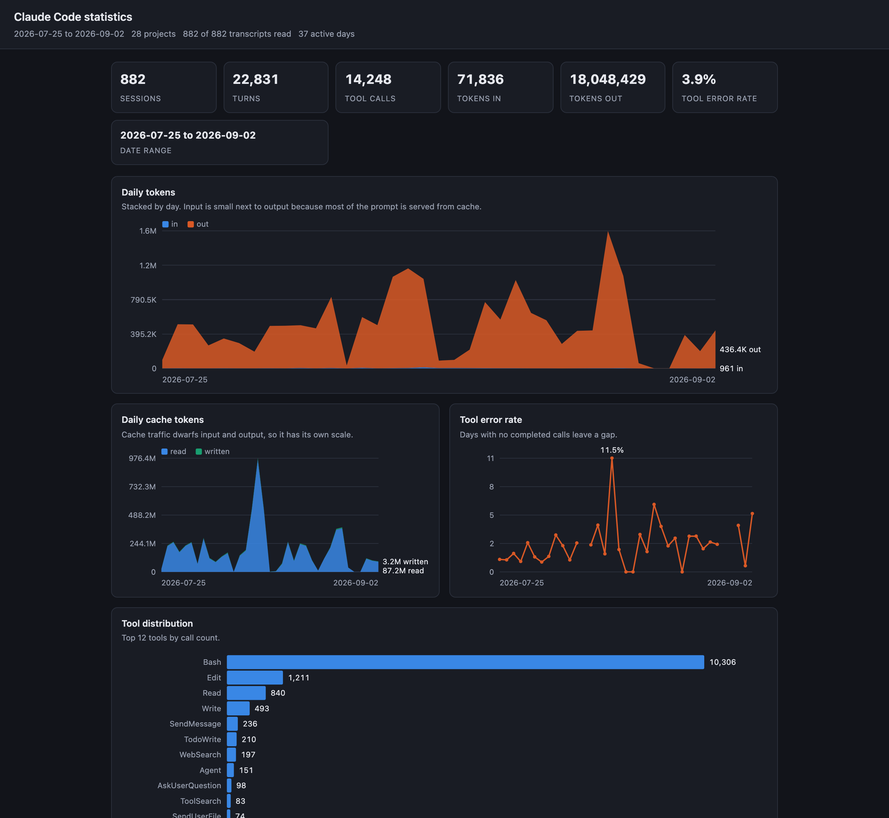

# cc-stats

Turn every Claude Code session on your machine into one self-contained HTML analytics dashboard.

## 한눈 요약

- `~/.claude/projects` 아래의 모든 세션 기록을 훑어 **대시보드 HTML 한 개**로 만들어 주는 CLI 입니다.
- 설치할 것이 없습니다. Python 3.9 이상이면 되고 **외부 의존성이 0개** 입니다 (표준 라이브러리만 사용).
- 바로 실행: `python3 -m cc_stats` → 현재 폴더에 `stats.html` 이 생깁니다.
- 토큰 사용량, 도구 사용 분포, 오류율, 프로젝트별 활동, 요일×시간 히트맵, 세션 길이를 한 화면에서 봅니다.
- 결과물에 **대화 내용은 전혀 들어가지 않습니다.** 숫자·날짜·도구 이름·정리된 프로젝트 이름만 담깁니다.
- 계정 이름과 홈 경로 등은 **기본으로 가려집니다** (`-Users-alice-code-app` → `code-app`).
- 자바스크립트가 한 줄도 없습니다. 모든 차트는 인라인 SVG 라서 오프라인에서 그대로 열립니다.

## What it is

Claude Code records every session as a JSON Lines file under `~/.claude/projects`. cc-stats reads
all of them and writes a single HTML page summarising how you actually work: tokens over time,
which tools you lean on, when you are active, how long sessions run, and how often tools fail.



## Why

The data is already on your disk and nobody looks at it, because it is thousands of unreadable
JSONL lines spread across dozens of directories. cc-stats answers the questions that data can
answer — where the tokens go, which tools matter, when you work — without uploading anything
anywhere and without putting a single message into the output.

## Quickstart

Requires **Python 3.9+**. There are **no dependencies** — standard library only.

```sh
git clone https://github.com/oh-namgyu/cc-stats.git
cd cc-stats
python3 -m cc_stats
```

That scans every project and writes `stats.html` in the current directory. Open it in any browser.

```sh
python3 -m cc_stats -o ~/Desktop/stats.html   # choose the output path
python3 -m cc_stats --days 30                 # only the last 30 days
python3 -m cc_stats --project=-Users-you-code # one project directory
```

`stdout` is exactly one line — the path written — so it composes: `open "$(python3 -m cc_stats)"`.
Scan counts and warnings go to `stderr`.

## CLI reference

| Flag | Default | Description |
| --- | --- | --- |
| `-o`, `--output` | `stats.html` | Where to write the dashboard. Parent directories are created. |
| `--days N` | all history | Only count events from the last N days, including today. |
| `--project NAME` | all projects | Limit to one project directory. Names begin with a dash, so use the `--project=NAME` form. |
| `--utc` | local time | Bucket days and hours in UTC instead of local time. |
| `--no-redact` | off | Show raw project directory names instead of prettified, redacted ones. |
| `--version` | — | Print the version and exit. |
| `-h`, `--help` | — | Show usage and exit. |

Transcripts are read from `~/.claude/projects`. If `CLAUDE_CONFIG_DIR` is set, that directory is
used instead of `~/.claude`.

Exit codes: `0` success (any unreadable files are reported on stderr), `1` nothing to render
(no transcripts, or nothing inside the selected window), `2` a usage or filesystem error.

## Metrics

The precision here is the point — these are the exact rules the numbers follow.

| Metric | Source | Deduplicated by | Sidechains |
| --- | --- | --- | --- |
| Daily tokens in / out / cache read / cache created | assistant `message.usage` | Last snapshot per `message.id`; streamed events repeat the block. Missing id falls back to the event `uuid` and increments an `idless` counter. | included |
| Tool distribution | `tool_use` blocks | `tool_use` id, so a repeated id counts once. Unnamed tools show as `(unknown)`. | included |
| Tool error rate | `tool_result.is_error` | Paired to its call by `tool_use` id; a duplicate result keeps the first and warns. | included |
| Sessions per project | the transcript's parent directory | one transcript is one session | — |
| Weekday × hour heatmap | every event timestamp | event `uuid` | included |
| Session length | first to last timestamp in a file | per session | — |
| Turns | user messages plus assistant messages | user events carrying real text, plus unique assistant `message.id` — one streamed message is one turn | **excluded** |

Further semantics:

- **Timezone.** Timestamps are ISO UTC and are converted with `astimezone()`, so day and hour
  buckets follow your local clock and stay correct across daylight-saving changes. `--utc` keeps
  everything in UTC. A timestamp without an offset is read as UTC.
- **`--days N`** is an event-level filter covering the last N days including today. Only events
  inside the window feed the token, tool, heatmap and turn metrics. A session counts if it has at
  least one event in the window, and its length still reports the full, unclipped span.
- **Error rate** is `error / (ok + error)`. Calls still awaiting a result, results with no matching
  call, and unreadable lines are counted separately and excluded from that denominator.
- **Robustness.** Unparseable lines are skipped and counted, a truncated final line (a session
  still being written) is handled, and unreadable files are skipped and reported rather than
  aborting the scan.
- **Memory** stays at roughly one transcript: per-file state is released before the next file.

Measured on ~830 MB of history (882 transcripts) on the development machine: a full scan and
render finishes in under two seconds and produces a ~45 KB page. Your numbers will differ.

## Privacy & redaction

**The dashboard contains no message content by design.** Nothing you or Claude wrote, and no tool
input or output, is ever written to the page. It holds only counts, dates, tool names and
prettified project labels.

Redaction is **on by default** and covers the labels that remain:

- Project directories are decoded from Claude Code's dash-encoded form and shown as their
  meaningful tail, with the home prefix removed: `-Users-alice-code-dev-tools` becomes
  `code-dev-tools`, and a home directory itself becomes `~`.
- Every label then passes through a redactor that masks account names, email addresses, API keys
  and tokens, and home paths, in case one is hiding in a directory name.

> Redaction is best effort, not a guarantee. It is pattern-based, so an unusual shape can slip
> through. **Review the page before sharing it.**

`--no-redact` shows raw directory names, which will include your account name.

Even fully redacted, the dashboard describes your working patterns — when you work, on how many
projects, how much you use each tool. Treat it as personal.

## Related tools

- [cc-replay](https://github.com/oh-namgyu/cc-replay) — sibling project: replays a single session
  transcript as a readable HTML timeline.
- [ccusage](https://github.com/ryoppippi/ccusage) — focuses on token cost reporting in the terminal.

## Development

No build step and no dependencies. Run the tests with the standard library:

```sh
python3 -m unittest discover -s tests -v
```

92 tests cover scanning, aggregation, chart generation, labels, the CLI and the rendered page.
They run on Python 3.9 through 3.12 and use synthetic fixtures only — no real transcript is ever
read by a test.

`cc_stats/_vendor/` holds unmodified copies of `parser.py` and `redactor.py` from
[cc-replay](https://github.com/oh-namgyu/cc-replay) at commit `04618de`. Do not edit them here:
fix upstream and re-sync so the copies stay diffable.

## License

MIT — see [LICENSE](LICENSE).
